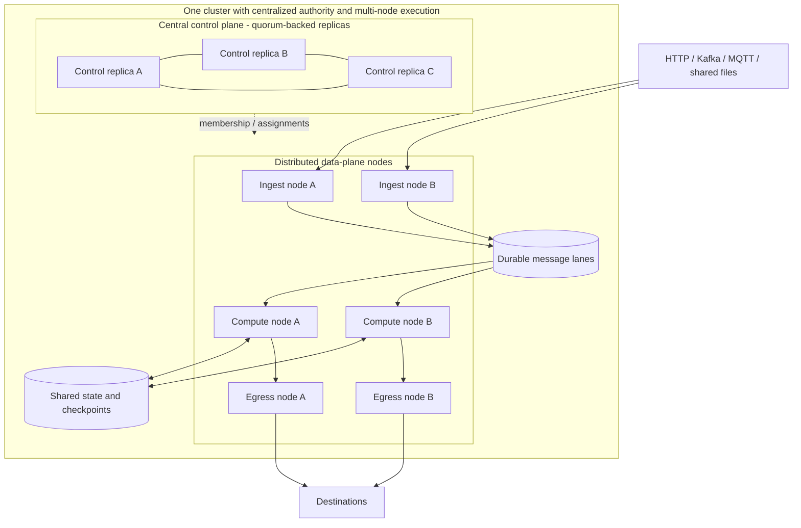
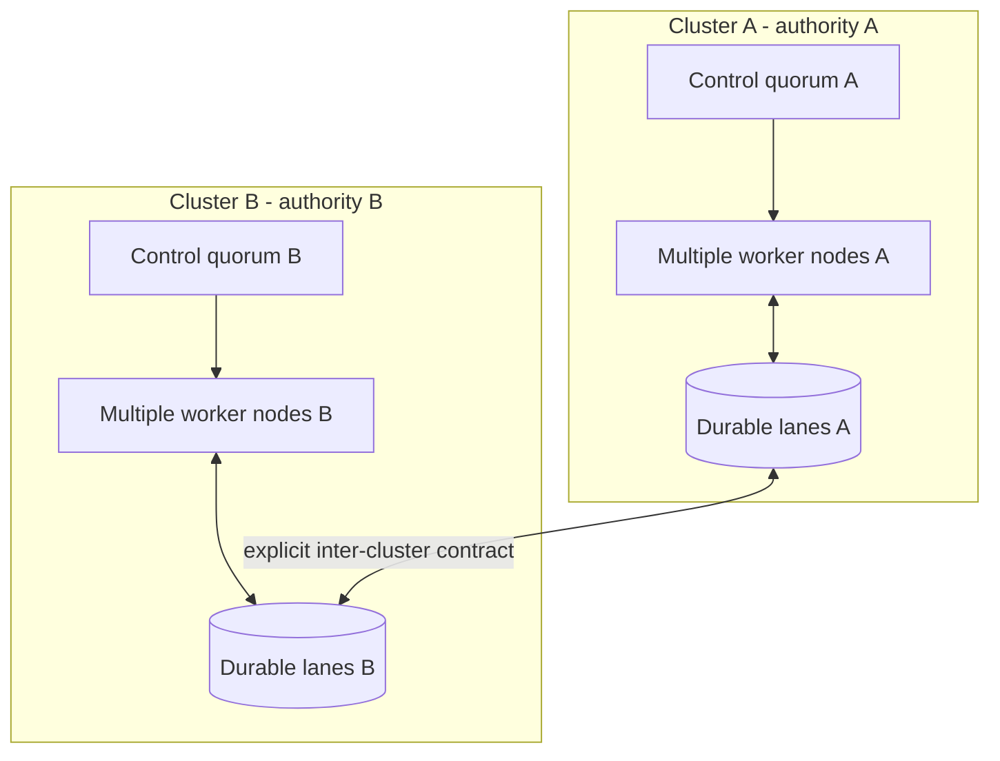

# Centralized and Distributed Deployment Modes

This repository remains a design and configuration template; neither mode is
implemented or runnable. This document separates two architecture dimensions
that are often conflated:

- **Control model:** one authoritative control plane for a cluster, or
  federated control across independently managed clusters.
- **Execution topology:** one node, or multiple data-plane nodes.

The requested **centralized multi-node** shape is a logically centralized,
high-availability control plane managing a distributed data plane. Centralized
authority does not mean a single control-plane process, one host, or one
failure point.

## Centralized control plane with multi-node execution

One logical control plane owns cluster membership, configuration, scheduling,
and partition assignment. Its API/service may run as a quorum-backed set of
replicas so the authority survives process/node loss. Multiple ingest,
compute, and egress nodes execute assigned work across the chosen failure
domains. The data plane communicates directly with durable messaging, state,
checkpoint, and sink services; event payloads do not pass through the control
plane.

Use this shape when the operational model requires one authoritative cluster
manager, while processing capacity or node-level resilience requires multiple
execution nodes. It can scale worker groups independently within the cluster
and keeps a single policy/assignment authority. It still requires quorum and
fencing for control-plane safety, durable shared dependencies, network
partition handling, failure-domain placement, backups, and tested recovery.

The control plane is a logical authority, not necessarily one service instance.
If quorum is lost, the system must not issue conflicting ownership changes.
Workers may continue only under a verified lease/fencing policy.
The separation between cluster-level assignment and job-level cross-node
synchronization is specified in
[`cross-node-coordination.md`](cross-node-coordination.md).
An optional full-node profile co-locates control participation and data-plane
capability on each node while retaining quorum/leader authority; see
[`full-node-cluster.md`](full-node-cluster.md).

## Federated multi-cluster mode

In a federated mode, multiple clusters have independent control-plane
authorities and operational boundaries. Work/data may be routed between them
through explicit inter-cluster contracts. Each cluster still has its own
multi-node data plane; federation adds cross-cluster identity, routing,
ownership, replication, and recovery questions.

Use federation only when separate administrative/security domains, geography,
or independently operated capacity require it. It is not a prerequisite for
multi-node execution. It increases failure and consistency complexity:
cross-cluster delivery, duplicate/replay behavior, data residency, identity
trust, and ownership transitions must be specified explicitly.

## Mode comparison

| Concern | Centralized control, multi-node data plane | Federated multi-cluster |
| --- | --- | --- |
| Control and deployment | One logical authority, replicated for HA; nodes join one cluster | Separate authorities and deployment/administration per cluster |
| Data-plane scale | Multiple worker nodes and roles scale within cluster partition limits | Scale within each cluster; federation does not remove per-cluster limits |
| Failure scope | Node/domain failures handled by local quorum, replication, and fencing; full-cluster recovery remains required | Cluster failures may be isolated, but cross-cluster failover requires explicit ownership and replay rules |
| Coordination | One membership/assignment authority with epoch fencing | Inter-cluster routing and ownership in addition to per-cluster coordination |
| Data path | Cross-node traffic within cluster; measured network/storage variance | Additional inter-cluster network, replication, and consistency costs |
| Operations | One policy boundary, though shared-cluster blast radius remains | More independent teams, policies, credentials, monitoring, and incident paths |
| Appropriate when | Central management is desired and multiple execution nodes are needed | Independent administrative/geographic domains are a requirement |

Neither mode receives an automatic delivery guarantee. Both use the same
default planning assumption of at-least-once delivery, stable event identity,
idempotent processing, bounded retries, and explicit source/sink commit
boundaries. Exactly-once claims require a verified transaction spanning the
actual input, state, and output boundaries.

## Shared contracts and mode-specific responsibilities

The following should remain mode-independent:

- event envelope, schema evolution, topic/lane semantics, and partition key;
- source acknowledgement only after durable handoff where supported;
- at-least-once replay and idempotent side effects;
- validation, quarantine, retry limits, backpressure, and tenant policy;
- observability fields, service objectives, security, and audit requirements.

Centralized-control deployments still require unique ownership of each ordered
partition, durable checkpoints, bounded queues, and safe restart/drain
behavior. A replicated control plane must maintain one authoritative epoch
history. Local process memory or a local lock is not a durable checkpoint or
cross-process lease.

Federated deployments additionally require cluster identity/trust, explicit
cross-cluster data and ownership contracts, replication/loop prevention,
regional or administrative failover policy, and reconciliation of state and
sink outcomes. The control-plane API alone cannot enforce downstream fencing.

## Choosing a mode

Decide using evidence rather than a preference for “more advanced” topology:

1. Define event/byte rates, event-size distribution, state cost, ordering
   scope, burst duration, sink limits, SLO, RPO, and RTO.
2. Load-test a centralized-control, multi-node cluster with intended durability
   and redundancy. Measure tail latency, sustained/burst throughput, replay,
   and node/domain recovery.
3. Identify the measured bottleneck: partition count/hot key, worker CPU or
   memory, network, state/checkpoint, broker, or source/sink quota.
4. Add execution nodes or failure domains when measurements/objectives justify
   them; add federation only for independent authority or geographic/
   administrative requirements.
5. Test the coordination, network, and recovery costs introduced by the
   chosen shape.
6. Record decision, assumptions, limits, and review trigger in the capacity
   worksheet and release record.

Do not hard-code the mode into event identity or business transformation
semantics. A mode change must preserve ordering/idempotency assumptions or
version them explicitly.

## Single-node-to-centralized-multi-node migration

1. Keep the event envelope, topic names/versions, partition key, and
   idempotency keys stable. Verify centralized producers/consumers can coexist
   with the target distributed version.
2. Establish the replicated control-plane authority and shared durable
   message/state/checkpoint services; validate backup and restore.
3. Enable the multi-node control and assignment protocol in a non-production
   environment; test quorum loss, stale-owner fencing, partition movement, and
   sink ambiguous outcomes.
4. Create a migration plan for partition mapping and committed offsets.
   Maintain one authoritative owner per partition; do not run both topologies
   as writers unless a tested fencing/dual-write protocol explicitly supports
   it.
5. Move a bounded canary set of partitions at a verified checkpoint, fence the
   old owner, assign a new epoch, restore state, and compare outputs/lag.
6. Expand in bounded batches only after correctness and SLO gates pass. Keep a
   rollback path that does not roll back epochs, discard accepted data, or
   replay non-idempotent sink effects.
7. Rehearse failback and document which topology owns each partition at every
   step. If a safe single-writer boundary cannot be established, pause the
   affected partitions rather than allowing dual writes.

Migration is not a simple replica-count change. It can alter partition
ownership, state locality, network paths, replay behavior, and failure scope.
Use [`deployment/release-readiness.template.md`](deployment/release-readiness.template.md)
to record the change and
[`operations/failure-drills.md`](operations/failure-drills.md) to validate it.

## Latency and real-time claims

Both shapes target low-latency streaming on general-purpose infrastructure.
Central control does not make a multi-node data path a single-node system:
cross-node messaging, state, and scheduling still add latency and failure
boundaries. Federation adds further network and coordination variance. Measure
end-to-end p50/p95/p99/max under steady, burst, failure, and recovery
conditions. Neither architecture alone provides hard-real-time guarantees.
