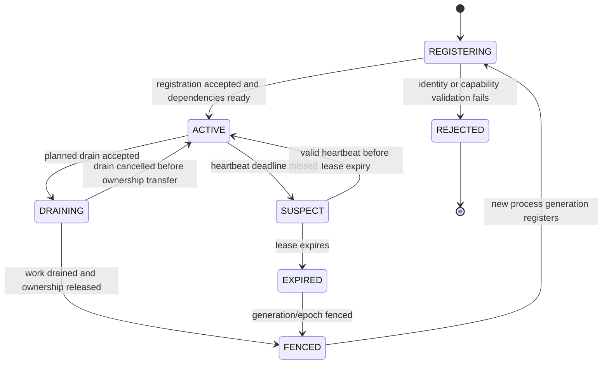

# Cluster Protocol: Membership, Assignment, and Consistency

This document specifies intended protocol semantics for the APIs in
[`interfaces/http/openapi.yaml`](../interfaces/http/openapi.yaml). It is a
design contract only; no control-plane or worker implementation currently
enforces these rules.
The intended topology is a logically centralized control authority with
multiple data-plane nodes; the authority may run as a quorum-backed replica set
and must not be implemented as an unsafe single writer without recovery.
In the optional full-node profile, each node can host a control participant and
data workers, but quorum/leader rules still determine the single authoritative
control history. See [`full-node-cluster.md`](full-node-cluster.md).
See [`architecture-modes.md`](architecture-modes.md) for the distinction
between centralized multi-node operation and federated clusters.
For network partition, split-brain, and end-to-end delivery decisions, see
[`consistency-delivery.md`](consistency-delivery.md).
The event envelope and topic/partition conventions are specified in
[`data-contracts-and-topics.md`](data-contracts-and-topics.md).
Cross-node dataflow barriers and plan-generation coordination are described in
[`cross-node-coordination.md`](cross-node-coordination.md); they build on, and
do not replace, the assignment epochs defined here.
Transport authentication, heartbeat sequencing, lease safety margins, and
reconnect behavior are specified in
[`node-communication.md`](node-communication.md).
Placement objectives, bounded rebalances, and load-signal requirements are in
[`task-scheduling-and-load-balancing.md`](task-scheduling-and-load-balancing.md).

## Node identity and lifecycle

Use a stable `nodeId` for a workload slot and a monotonically increasing
`generation` for each new process incarnation. A restarted process must use a
new generation; heartbeats from an older generation are rejected. A monotonically
increasing heartbeat `sequence` rejects stale/reordered heartbeats within one
generation. Identity must be authenticated and bound to the registered role;
client-supplied role alone is not authorization.

The control plane is authoritative for lease expiry; workers must not infer
ownership solely from their own wall clock. Lease renewal and ownership writes
must use a monotonic control epoch/fencing token enforced by the message/state
services. A partition must not have two valid writers, even during a network
partition. If fencing cannot be established, fail closed and pause writes.

Suggested transition requirements:

| Transition | Required condition |
| --- | --- |
| `REGISTERING → ACTIVE` | Authenticated identity, unique current generation, compatible protocol version, required dependencies healthy |
| `ACTIVE → SUSPECT` | Heartbeat sequence has not advanced within configured grace |
| `SUSPECT → EXPIRED` | Authoritative lease expired; no local-clock-only decision |
| `ACTIVE → DRAINING` | Authenticated drain request or orchestrator termination notice |
| `DRAINING → FENCED` | Intake stopped, assigned work drained/checkpointed or explicitly abandoned, old epoch rejected by storage |
| `EXPIRED → FENCED` | Control plane establishes a strictly newer epoch before reassignment |

Registration should be idempotent for the same identity/generation and reject
conflicting active generations. Preserve a bounded tombstone or generation
record so a delayed heartbeat cannot resurrect a fenced process.

## Partition assignment lifecycle

An assignment is scoped by `(clusterId, sourceId, partitionId, epoch,
ownerNodeId, ownerGeneration)`. `epoch` must increase whenever ownership
changes. The fencing token is opaque, short-lived, bound to that tuple, and
validated by every service that accepts writes or commits.

```mermaid
stateDiagram-v2
    [*] --> UNASSIGNED
    UNASSIGNED --> PREPARING: control plane selects owner and epoch
    PREPARING --> ACTIVE: new owner restored state and acked epoch
    PREPARING --> REVOKING: owner failed or plan superseded
    ACTIVE --> DRAINING: scale-in, maintenance, or rebalance
    DRAINING --> REVOKING: checkpoint committed and intake stopped
    DRAINING --> REVOKING: drain deadline expires; fence old owner
    REVOKING --> PREPARING: prior epoch fenced; assign newer epoch
    REVOKING --> UNASSIGNED: no eligible owner; pause partition
```

Protocol rules:

1. Create a new assignment epoch with compare-and-set in the authoritative
   coordination store.
2. Fence the old owner before granting write-capable credentials to a new owner.
3. The new owner restores the last committed checkpoint, then acknowledges the
   exact epoch and prepared partition set.
4. Only after acknowledgement may the source/consumer resume at the agreed
   starting position.
5. Commit output/state and source progress according to the selected delivery
   contract; never acknowledge an epoch that has been superseded.
6. If drain times out, fence and replay from the last committed position;
   tolerate duplicates through idempotent state/sink operations.

The API currently models assignment snapshots and acknowledgements, but
implementation must bind them to authenticated node generation and enforce
fencing at the actual write/commit boundary. An API-level lease without
downstream enforcement is insufficient.

## Consistency and commit model

Define a per-partition commit record that ties together:

- input message position/range and message-bus acknowledgement;
- state-store updates or transaction identifier;
- output delivery/idempotency result where required;
- schema and processing version;
- checkpoint sequence and assignment epoch.

The preferred abstract sequence is:

1. Read input under the current assignment epoch.
2. Apply deterministic/idempotent transformation.
3. Persist state and output using a supported transaction, or use an
   idempotency/outbox protocol when cross-service atomic transactions are
   unavailable.
4. Persist the checkpoint/commit marker only after the required durable writes
   succeed.
5. Acknowledge input only after that commit marker is durable.

This sequence is not universally implementable as one atomic transaction across
independent systems. The selected broker, state store, and sink determine the
actual guarantees. If a step fails, retry from the last committed position and
deduplicate by stable event/idempotency key. Do not claim exactly-once without
proving the full source-to-state-to-sink protocol.

## Failure matrix

| Failure | Required reaction | Recovery point / safety rule |
| --- | --- | --- |
| Worker process exits | Mark node suspect/expired; fence its assignment; reassign after epoch advance | Last durable per-partition checkpoint; replay may duplicate |
| Node network-isolated from control plane | Stop lease-dependent writes when authority cannot be renewed | Fail closed; avoid split-brain writers |
| Control-plane leader/quorum unavailable | Do not make conflicting membership or assignment changes | Existing valid owners may continue only within explicit lease policy; no new ownership |
| Message-bus partition unavailable | Pause affected ingestion/consumption and expose lag/degraded health | Resume from broker-committed position; never skip uncommitted input |
| State-store unavailable | Stop commits; do not acknowledge input whose state is not durable | Retry from last committed checkpoint |
| Checkpoint-store unavailable | Stop advancing durable input progress | Replay from last checkpoint after recovery |
| Sink timeout after possible write | Retry with stable idempotency key or query sink outcome | Treat delivery as unknown, not failed-successfully |
| Assignment acknowledgement lost | Retry idempotently for the same epoch or query current assignment | Reject acknowledgements for stale epochs |
| Zone/failure-domain loss | Recompute eligible owners only after fencing old epochs | Restore state and replay from durable shared services |
| Schema rollout incompatibility | Hold or route incompatible events; do not silently reinterpret | Roll back or perform explicit versioned migration |

## Required protocol tests

- Duplicate, delayed, and reordered registration/heartbeat requests.
- Process restart with a new generation while old messages remain in flight.
- Lease expiry during a network partition and attempted stale-owner writes.
- Concurrent assignment changes, lost acknowledgements, and stale epoch commits.
- Worker crash before and after state, sink, checkpoint, and input acknowledgement.
- Control-plane quorum loss and recovery without split-brain ownership.
- Rolling schema upgrade with old/new worker versions consuming retained events.

## Security review checklist

Before exposing the control API or allowing a worker to process partitions,
review and test all of the following:

- **Identity:** authenticate nodes with workload identity or short-lived
  credentials; bind identity to approved cluster, role, and node generation.
  Do not trust `nodeId`, `role`, `zone`, or capabilities solely because the
  client supplied them.
- **Authorization:** enforce role- and resource-scoped permissions. A worker may
  read/ack only its current assignments; only authorized control-plane
  principals may assign, drain, or revoke nodes.
- **Fencing:** validate assignment epoch and fencing token at every state,
  checkpoint, broker commit, and sink write boundary. Reject stale tokens
  consistently, including after control-plane failover.
- **Replay protection:** make registration and drain operations idempotent;
  reject stale generations, heartbeat sequences, and assignment acknowledgments.
  Bound request age and size.
- **Lease safety:** define authoritative lease time, renewal margin, clock-skew
  assumptions, and fail-closed behavior. Never grant a new owner while an old
  owner can still commit.
- **Transport and secrets:** require authenticated encrypted transport;
  rotate and revoke credentials; keep secrets out of YAML, logs, traces, error
  bodies, and metric labels.
- **Input validation:** validate protocol versions, capability lists, IDs,
  partition ranges, timestamps, and metrics. Apply rate limits and payload
  limits to control endpoints.
- **Auditability:** record actor, node generation, epoch, assignment changes,
  revocations, and administrative actions without recording tokens or payload
  secrets.
- **Failure testing:** verify unauthorized reassignment, replayed heartbeat,
  stolen/expired token, stale-owner write, and control-plane partition all fail
  safely.

Treat any failure to prove authentication, authorization, and fencing as a
release blocker; health endpoints may expose only the minimum non-sensitive
status needed by their caller.
