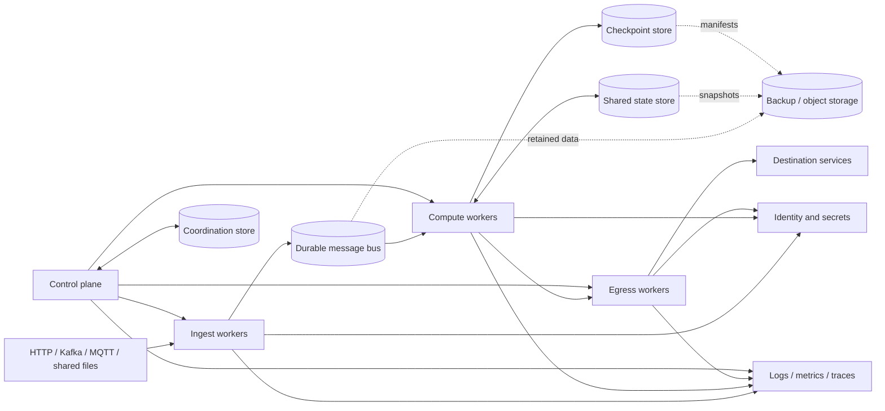

# Cluster Dependencies and Environment Checklist

This is a deployment planning checklist, not a deployable manifest. No
environment-specific endpoints, credentials, or provider choices are supplied.
Configure secrets through an approved secrets manager or workload identity;
never commit secret values.
The sizing worksheet at
[`../../deployments/topologies/production-capacity.template.yaml`](../../deployments/topologies/production-capacity.template.yaml)
is intentionally all `TBD` until load-test and service-objective inputs exist.

## Service dependency map

| Service | Used by | Required properties to decide |
| --- | --- | --- |
| Orchestrator / scheduler | Control plane and worker groups | Node health, restart policy, placement, graceful termination, resource limits |
| Control-plane coordination store | Membership and partition assignment | Quorum/consistency model, lease expiry, fencing, failure-domain placement |
| Durable message bus | Ingest, compute, and egress | Replication, retention, partition count, ordering, acknowledgements, replay |
| Shared state store | Stateful compute and deduplication | Consistency, atomic updates, partitioning, failover, backup/restore |
| Checkpoint store | Workers and recovery controller | Atomic per-partition commits, versioning, retention, restore semantics |
| Source services | Source connectors | Network access, authentication, quotas, cursor/partition behavior |
| Sink services | Egress connectors | Network access, authentication, idempotency, delivery acknowledgement |
| Secrets / identity provider | All workloads and operators | Workload identity, least privilege, rotation, revocation, audit |
| Telemetry backend | Nodes and operators | Metrics, logs, traces, retention, access control, alert routing |
| Backup/object storage | Recovery operations | Separate failure domain, encryption, integrity verification, restore testing |

The required telemetry signals, bounded dimensions, redaction, and degraded
backend behavior are specified in
[`../observability.md`](../observability.md).

## Failure impact and safe behavior

| Dependency failure | Expected impact | Safe behavior to specify and test |
| --- | --- | --- |
| Control-plane coordination quorum | Cannot safely establish membership or new ownership | Stop new assignments; retain/fence owners only while their lease and epoch authority remain valid |
| Message bus | Ingest or replay may stop; lag grows | Do not acknowledge input beyond durable progress; isolate affected partitions and preserve replay data |
| Shared state store | Stateful computation may be unavailable or inconsistent | Pause affected partitions; do not advance checkpoints past durable state |
| Checkpoint store | Recovery position becomes uncertain | Stop progress that cannot be committed; restore from a verified consistent checkpoint |
| Identity/secrets provider | Workloads may be unable to authenticate or rotate credentials | Do not fall back to embedded/static credentials; preserve current authorized sessions only per policy |
| Sink service | Outputs may be delayed or have ambiguous outcomes | Retry with stable idempotency keys or reconcile before re-delivery |
| Telemetry backend | Detection and diagnosis degrade | Keep bounded local buffering where supported; use the approved out-of-band incident channel |
| Backup/object storage | Restore points may be inaccessible or stale | Do not claim RPO; pause destructive repair and locate another verified copy |

Draw a provider-specific network/dependency diagram before deployment. For each
service, document owner, endpoint discovery, port/protocol, DNS requirements,
availability target, failure mode, and recovery procedure.

## Non-secret environment variable names

The following names are suggested interfaces only; no application currently
reads them. Supply values through the deployment platform and secret manager.

| Variable | Purpose | Secret? |
| --- | --- | --- |
| `STREAM_CLUSTER_ID` | Logical cluster identity | No |
| `STREAM_NODE_ID` | Stable workload instance identity | No |
| `STREAM_NODE_ROLE` | `control`, `ingest`, `compute`, or `egress` | No |
| `STREAM_CONTROL_API_URL` | Control-plane API endpoint | No |
| `STREAM_MESSAGE_BUS_URL` | Message bus bootstrap/endpoint | Usually no; credentials separate |
| `STREAM_STATE_STORE_URL` | Shared state endpoint | Usually no; credentials separate |
| `STREAM_CHECKPOINT_STORE_URL` | Shared checkpoint endpoint | Usually no; credentials separate |
| `STREAM_CONFIG_PATH` | Mounted non-secret runtime configuration | No |
| `STREAM_LOG_LEVEL` | Runtime logging verbosity | No |
| `STREAM_OTEL_EXPORTER_ENDPOINT` | Telemetry collector endpoint | No |
| `STREAM_WORKLOAD_IDENTITY` | Workload identity selector/reference | No |

Credentials, tokens, private keys, certificates, and passwords must be injected
through the platform's secret mechanism; do not add `*_PASSWORD` or token values
to checked-in examples. Do not log environment dumps.

## Pre-deployment checklist

- Select orchestration, message bus, coordination, state, checkpoint, identity,
  secrets, telemetry, and backup providers.
- Specify zone/failure-domain layout, replication factors, quorum behavior,
  capacity, resource requests/limits, and network policies.
- Define node identity and generation, heartbeat interval, lease duration,
  partition epoch/fencing, drain deadline, and rebalance limits.
- Define source and sink credentials, least-privilege scopes, rotation, TLS,
  quotas, and allowed egress.
- Set message/state/checkpoint retention, schema compatibility, backup
  frequency, RPO/RTO, and isolated restore-test cadence.
- Set SLOs and alert thresholds for end-to-end tail latency, input/output lag,
  queue depth, rebalance time, error/retry rate, and dependency health.
- Validate failure of a zone, broker, state-store member, worker, and control
  plane before enabling production traffic.
