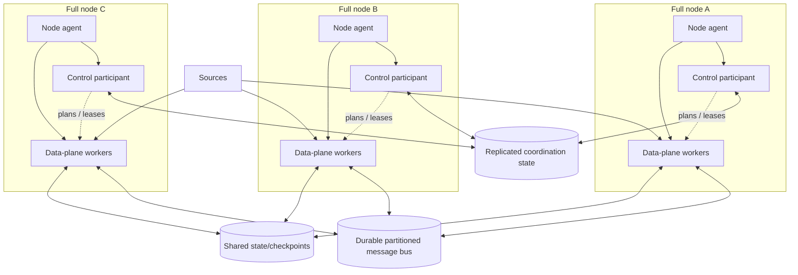

# Full-Node Cluster Architecture

This is a design profile for a multi-node cluster in which every node carries
both control-plane participation and data-plane execution capability. It is
not implemented or deployable from this repository. See
[`architecture-modes.md`](architecture-modes.md) for other deployment shapes
and [`cluster-protocol.md`](cluster-protocol.md) for membership and fencing
protocol requirements.

## Meaning of “full node”

Each full node is provisioned to host:

1. A node agent for identity, health, heartbeat, local lifecycle, and
   assignment handling.
2. A control-plane participant that replicates authoritative coordination
   state and can participate in leader/quorum decisions.
3. Data-plane worker capability for ingest, compute, and egress, subject to
   assigned work and local resource budgets.

Full-node does **not** mean:

- every node is an independent control-plane leader;
- every node processes every event or writes every partition;
- control-plane consensus messages carry event payloads;
- local process memory or local disk is the shared source of truth;
- quorum loss is handled by allowing multiple sides to continue making
  conflicting assignments.

The intended model is one logical authority backed by a quorum-replicated
control state. At most the consensus protocol's elected leader (or equivalent
authorized coordinator) commits mutations at a time. Other control-plane
participants replicate/serve permitted state and may take leadership only
through the consensus protocol. Data-plane work remains partitioned: one
fenced active owner per partition, with replay and idempotency as documented.

## Node composition

The diagram shows capability, not a mandatory one-process-per-role layout.
Control and data workers can be separate processes or containers on the same
node. This separation is recommended when data-plane resource spikes could
starve control-plane heartbeats, consensus, or fencing. Co-location requires
hard resource reservations and stress tests proving control-plane safety under
maximum data-plane load.

See [`../deployments/topologies/full-node.example.yaml`](../deployments/topologies/full-node.example.yaml)
for a technology-neutral topology intent template. All counts and resource
values remain `TBD`.

## Authority and work ownership

- Bind each node's control and data processes to an authenticated cluster
  identity, stable node ID, and increasing process generation.
- Maintain a quorum-backed monotonic term/epoch and assignment history. A
  leader election alone does not fence an old leader from downstream writes.
- Validate assignment epochs and fencing tokens at every state, checkpoint,
  broker, and sink boundary capable of committing work.
- Keep each ordered partition assigned to at most one active writer. A node
  can own many partitions; a partition is not broadcast for independent
  processing to every full node.
- Replicate control metadata and durable data according to separate policies.
  Consensus replication of membership/assignments is not a substitute for
  replicated event retention, state, or checkpoints.
- Apply one consistent placement policy across all eligible nodes, considering
  role capability, partition parallelism, state locality, failure domains,
  tenant quotas, and reserved recovery capacity.
- If no valid leader/quorum or eligible fenced owner exists, pause affected
  changes/work and alert. Do not self-elect outside the consensus protocol or
  use node-local locks as a fallback.

## Failure and overload behavior

| Condition | Required behavior |
| --- | --- |
| Full node process restart | Register with a new generation; load the authoritative plan; reject stale local state/credentials |
| Control participant loses quorum | Do not commit membership/plan/assignment mutations; workers continue only within proven lease/fencing policy |
| Old control leader returns after election | Reject stale term at coordination and downstream write boundaries; audit the rejection |
| Data-plane overload on a full node | Preserve reserved control-plane CPU/memory/network; apply backpressure or shed only pre-acceptance work |
| Node loss removes quorum | Fail closed for new assignments; recover quorum before granting replacements |
| Node loss removes partition owner | Fence its epoch, restore checkpoint on an eligible node, then replay with idempotency |
| All nodes run every control replica without capacity review | Treat as an invalid sizing assumption; consensus and data workloads may compete and increase failure coupling |
| Network split creates isolated groups | Only the quorum side may mutate authority; minority-side workers stop lease-dependent writes before safety margin |

The failure policy must distinguish loss of a worker process from loss of the
node's control participant. A node may remain reachable for data traffic while
isolated from quorum; it still cannot invent or renew assignment authority.

## Capacity and placement

Every-node capability improves placement flexibility, not necessarily
throughput. Aggregate capacity is still bounded by partitions, hot keys,
shared-service limits, event processing cost, and destination quotas. Full-node
co-location can reduce placement rigidity but increases contention between
control and data workloads.

Before production, define and test:

- quorum size, failure domains, leader transition, and control-plane reserved
  CPU/memory/network under maximum data-plane load;
- per-node worker budgets and headroom for recovery, rebalances, and catch-up;
- maximum active partitions, in-flight records/bytes, state cache, retry
  backlog, and telemetry buffers per node;
- anti-affinity/placement, drain deadlines, and minimum surviving capacity;
- node count versus useful partition parallelism and safe state restore rate;
- behavior when a maintenance or outage removes both a leader and a worker
  capacity margin.

Do not use “all nodes can run a role” to imply unlimited elastic capacity.
Record measured capacity, SLO, RPO/RTO, and recovery throughput in
[`../deployments/topologies/production-capacity.template.yaml`](../deployments/topologies/production-capacity.template.yaml)
and validate using [`multi-instance-operations.md`](multi-instance-operations.md).

## Startup, rolling maintenance, and shutdown

1. Provision quorum-backed coordination and shared durable data dependencies.
2. Start node agents and control participants; wait for a single authoritative
   quorum and verify term/epoch history.
3. Register node generations and verify control resource reservations before
   admitting data-plane workers.
4. Start data-plane capabilities, but do not consume or publish until
   dependencies, schemas, assignments, and fencing checks are ready.
5. Activate partitions in bounded batches after exact-generation/epoch
   acknowledgements and successful canary validation.
6. During rolling maintenance, preserve quorum and recovery headroom. Drain
   data-plane ownership before stopping a node; never remove enough control
   participants at once to lose quorum.
7. For full shutdown, pause intake, drain/commit or retain replayable work,
   fence assignments, then stop data workers. Stop control participants only
   after ownership is safely paused/released, following the provider's
   consensus-safe procedure.

Use [`deployment/cluster-bootstrap-runbook.md`](deployment/cluster-bootstrap-runbook.md)
for the provider-neutral bootstrap and shutdown gates. It is a template, not a
command sequence.
For rolling software, protocol, schema, and state upgrades while preserving
quorum and fencing, use
[`operations/full-node-upgrade-runbook.md`](operations/full-node-upgrade-runbook.md).

## Required full-node drills

Run in a non-production environment first:

- data-plane CPU/memory/network saturation while validating control heartbeat
  and quorum latency;
- leader loss while leader and followers each own data partitions;
- quorum loss with data paths still open on both sides;
- return of stale leader/node generation attempting plan and data commits;
- rolling maintenance at the maximum allowed concurrent node loss;
- node failure during state restore, checkpoint commit, and sink ambiguous
  timeout;
- recovery throughput when several nodes and partitions fail together.

Pass only if there is one authoritative control history, no dual partition
writer, no acknowledged data loss outside the approved contract, and recovery
and latency objectives are met. Record evidence using
[`operations/recovery-drill-record.template.md`](operations/recovery-drill-record.template.md).

## Scope and performance claims

The full-node shape is a low-latency distributed design for general-purpose
infrastructure. Consensus, storage, scheduling, and network delays remain
variable. It is not a hard-real-time system, and “full-node” does not imply
high throughput without benchmark evidence.
