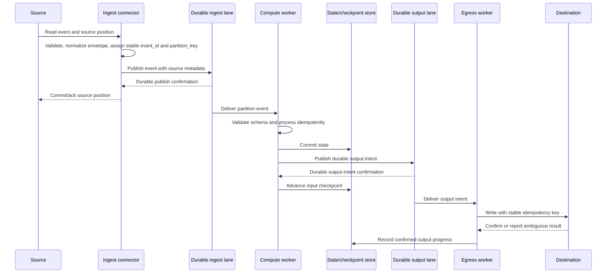

# Event Processing Lifecycle

This document defines the intended lifecycle across source, compute, and sink
boundaries. It is a design contract only; this repository contains no runtime
that enforces these transitions. The event shape and topic lanes are defined
in [`data-contracts-and-topics.md`](data-contracts-and-topics.md), while
cross-service commit and replay requirements are in
[`consistency-delivery.md`](consistency-delivery.md).
Source-specific cursor and acknowledgement behavior is detailed in
[`source-adapters.md`](source-adapters.md).
Destination-specific confirmation and idempotency requirements are detailed in
[`sink-adapters.md`](sink-adapters.md).

## Lifecycle

## Stage requirements

### Source ingestion

1. Read an event together with the source-specific position/cursor.
2. Validate the input, construct the versioned event envelope, and assign a
   stable `event_id` and business-meaningful `partition_key`. Retrying the same
   source record must reproduce both values.
3. Publish to the durable ingest lane with source identity and position in
   transport metadata.
4. Commit/ack the source position only after durable publish confirmation.
   When the source cannot defer acknowledgement until then, document its loss
   window and do not claim the same delivery guarantee.
5. Invalid input must be quarantined or rejected with an explicit measurable
   outcome; never report it as successfully ingested.

### Compute and state

1. Process only partitions for which the worker can prove current assignment
   epoch and fencing authority.
2. Validate the envelope/schema version before applying transformations.
3. Preserve `event_id` and `partition_key` on derived events unless an explicit
   transformation contract defines a new identity and lineage relationship.
4. Apply state changes idempotently or transactionally. Keep an event's
   processing result, state version, and source position associated with the
   same partition epoch.
5. Advance the input checkpoint only after state and required durable output
   intents are committed, unless a tested transaction covers them atomically.
   Never advance beyond a gap in the ordered input partition.

### Egress and side effects

1. Consume durable output intents independently from compute progress so sink
   outages do not require re-running unrelated computation.
2. Send the same stable idempotency key on every retry of an output intent.
3. Treat a timeout after a possible destination write as an unknown outcome:
   reconcile with the destination or retry using its idempotency contract.
4. Mark output progress only after destination confirmation or verified
   reconciliation. Do not infer success from a client-side timeout or
   connection close.
5. If the destination offers neither idempotency nor outcome reconciliation,
   document the duplicate/loss trade-off and require explicit approval.

## Failure, retry, and backpressure

- **Transient dependency failure:** pause or slow consumption before bounded
  buffers are exhausted. Do not acknowledge past durable progress.
- **Retryable event failure:** retry with a bounded attempt count, a delay and
  jitter policy, and the original event identity. Define retry retention and
  maximum event age.
- **Poison or invalid event:** route to an access-controlled, redacted
  dead-letter lane with failure class, stage, schema version, source position,
  and attempt metadata. Avoid copying secrets or unrestricted payload data into
  logs.
- **Retry exhaustion:** stop retrying automatically and alert an owner. Re-drive
  only after correction, with authorization and an audit record.
- **Sustained overload:** apply source-native flow control or pause reads. If
  the source cannot pause, define a durable spool and its capacity/expiry
  behavior before production.
- **Capacity exhaustion:** fail visibly and preserve replayability; never turn
  queue overflow into silent dropping.

All limits, delays, retention windows, and maximum event ages are deployment
inputs and remain `TBD` until load-tested and approved.

## Required correctness tests

For each supported source-to-sink path, test crashes immediately before and
after each durable boundary: source acknowledgement, bus publish, state write,
output-intent publish, sink write, and progress/checkpoint commit. Also verify:

- retries preserve the same event and idempotency keys;
- a stale assignment epoch is rejected at every write boundary;
- ambiguous sink outcomes can be reconciled or safely retried;
- source backpressure does not skip positions or silently discard events;
- poison events are bounded, observable, redacted, and safely re-drivable;
- per-key order survives retry, rebalance, and recovery under the declared
  contract.
