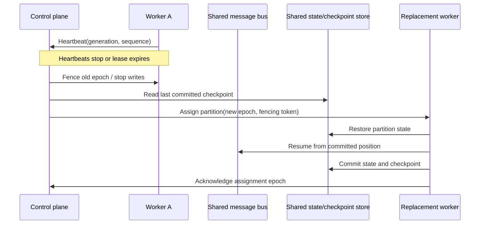
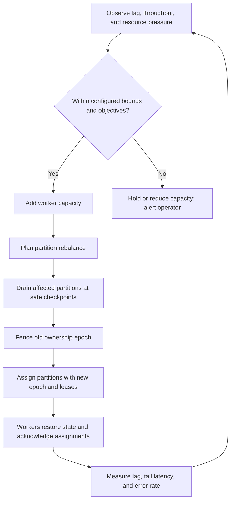

# Distributed Runtime Architecture

This document describes a centralized control plane managing a distributed,
multi-node data plane. “Centralized” means one logical authority, not one
control-plane process; use quorum-backed replicas for availability. The
federated alternative and single-node migration guidance are in
[`architecture-modes.md`](architecture-modes.md). This is a design plan, not a
runnable deployment. No cluster control plane, data plane, connector, or
supervisor has been implemented.
For the distinction between cluster membership/assignment and pipeline-level
cross-node barriers and stage coordination, see
[`cross-node-coordination.md`](cross-node-coordination.md).

## Logical architecture

```text
                       Control plane
          membership ─ health ─ scheduling ─ partition assignment
                            │
Sources                    │                    Destinations
  │                         │                         ▲
  ▼                         ▼                         │
Source connectors ──> Durable shared message bus ──> Sink connectors
                                │
                                ▼
                    Partitioned worker groups
                    ingest → compute → egress
                                │
                                ▼
                  Shared state/checkpoint services
```

- **Control plane** tracks node membership and health, assigns partitions, and
  coordinates rebalancing. It should not carry the event data path.
- **Ingest nodes** run source connectors and publish validated, identified
  events to the shared bus.
- **Compute nodes** consume assigned partitions, process events, and persist
  state/checkpoint progress through shared services.
- **Egress nodes** deliver results to sinks and commit/acknowledge work only
  according to the selected delivery contract.
- **Shared platform services** provide durable messaging, coordination,
  checkpointing, state storage, secrets, and telemetry. These are external
  cluster dependencies, not local folders or bundled services in this repo.

## Partition ownership and rebalancing

Partitions are the unit of ordered processing and parallelism. The control
plane assigns each partition to one active worker group member according to a
source-specific strategy. A shard may bundle partitions for scheduling, but
must not weaken per-partition ordering guarantees.

On node loss, stop or fence the previous owner before granting a new ownership
lease. Rebalance only at safe checkpoints; account for in-flight messages and
commit offsets after the corresponding state/output guarantees are satisfied.
Use idempotency keys or deduplication where retries can produce duplicate
delivery. Never treat a local PID/lock file as a cross-node lease.

Kafka partition assignment is broker-managed. HTTP polling needs partitioned
queries, cursor ownership, or a distributed lease. MQTT requires explicit
shared-subscription/client semantics. File input must be on shared storage or
use a distributed listing/claim mechanism; independent node-local watchers
cannot safely share ownership.

The planned control API is described in
[`interfaces/http/openapi.yaml`](../interfaces/http/openapi.yaml). Node
registration is idempotent for the same identity and generation; heartbeats
renew a bounded lease; assignments carry a monotonically increasing epoch and
fencing token. Nodes acknowledge a new epoch only after they have stopped or
prepared the affected partitions. A stale epoch must never be allowed to write
or commit offsets.

## Node failure and recovery flow



If the previous owner cannot be fenced, do not assign the partition to a new
writer until the lease/epoch protocol makes concurrent ownership impossible.
Recovery replays from the last committed position; sinks must tolerate replay
through idempotency or deduplication.

## Horizontal scaling flow



Scale-out is useful only when there are enough independently processable
partitions. Scale-in follows the same drain/fence/assign sequence and must not
remove the last healthy owner for a required role. Autoscaling must use bounded
step sizes, cooldowns, and rollback/alert behavior to avoid rebalance thrashing.
The multi-instance placement, capacity, backpressure, and acceptance checklist
is in [`multi-instance-operations.md`](multi-instance-operations.md).

## Consistency and failure boundaries

The durable message bus, state store, checkpoint store, and sink commit behavior
must be selected together. Define at-least-once/exactly-once expectations,
ordering scope, retention, replay, duplicate handling, and transaction
boundaries before implementation. End-to-end exactly-once behavior cannot be
assumed from a directory layout or a broker feature alone.

Keep authoritative offsets, partition leases, and checkpoints in services
designed for shared, durable access. Local disk may be used as a bounded cache
or temporary spool only with explicit node-loss and replay semantics; it is not
the system of record. Back up shared state and message retention independently
and regularly test recovery into a separate environment.

## Deployment and operations

The example topology under `deployments/topologies/` illustrates roles and
replica intent only. A future deployment should provide:

1. Required network, identity, secrets, and external service configuration.
2. Shared message/state/checkpoint dependencies and their health checks.
3. Control-plane quorum/availability appropriate to the selected technology.
4. Worker groups with resource limits and replica counts per role.
5. Readiness and liveness checks, rolling upgrades, drain/rebalance handling,
   and bounded retry policies.
6. Cluster-wide logs, metrics, traces, lag, queue depth, rebalance, and
   dependency health monitoring.

Do not start workers before their shared dependencies are ready. During
shutdown, stop intake, drain or checkpoint work, release/fence partition
ownership, and then terminate nodes. During rolling upgrades, maintain
backward-compatible event contracts or coordinate schema migration.
For the detailed provider-neutral startup, canary, abort, and shutdown
sequence, see
[`deployment/cluster-bootstrap-runbook.md`](deployment/cluster-bootstrap-runbook.md).

## Real-time scope

This is a distributed low-latency design on general-purpose infrastructure,
not a hard-real-time system. Network hops, distributed coordination, storage,
broker queues, scheduling, and retries add variable latency. Hard-real-time
claims require a specified bounded system, deadlines, hardware/OS, and
end-to-end worst-case timing analysis and verification.
